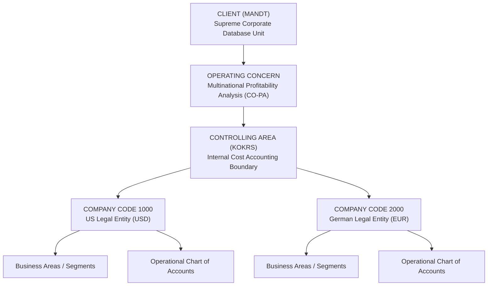
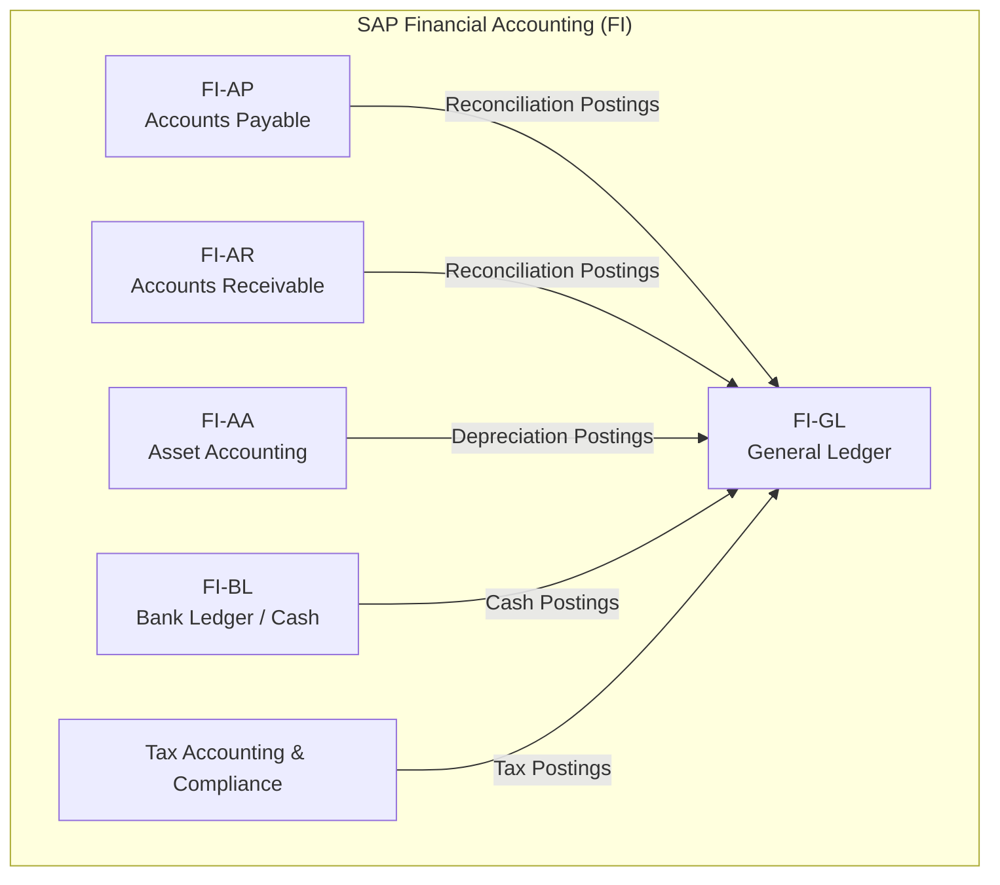
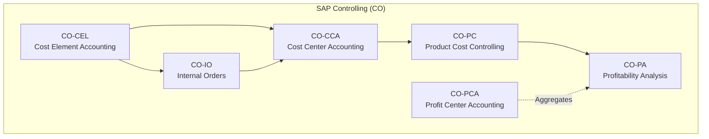
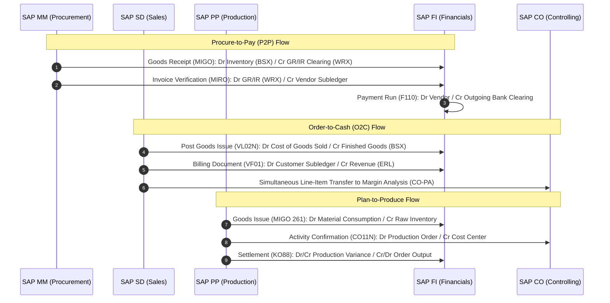

# Week 1 Task: Understanding SAP FICO — Comprehensive Research Report

> **Document Type:** Formal Research Report & Executive Technical Deliverable  
> **Course / Workstream:** Enterprise Financial Systems Architecture & Implementation  
> **Topic Domain:** SAP ERP Financial Accounting (FI) & Management Controlling (CO)  
> **Software Scope:** SAP ECC 6.0 & SAP S/4HANA Enterprise Management  
> **Primary Deliverables:** 
> - Microsoft Word Document (.docx): [`SAP_FICO_Comprehensive_Research_Report.docx`](file:///C:/Users/prath/.gemini/antigravity/scratch/SAP_FICO_Research_Report/SAP_FICO_Comprehensive_Research_Report.docx)
> - Microsoft Word Document (.doc): [`SAP_FICO_Comprehensive_Research_Report.doc`](file:///C:/Users/prath/.gemini/antigravity/scratch/SAP_FICO_Research_Report/SAP_FICO_Comprehensive_Research_Report.doc)
> - Formatted Web Source (.html): [`SAP_FICO_Comprehensive_Research_Report.html`](file:///C:/Users/prath/.gemini/antigravity/scratch/SAP_FICO_Research_Report/SAP_FICO_Comprehensive_Research_Report.html)
> **Author / Role:** Enterprise Financial Systems Research & Architecture  
> **Date:** October 2026 | **Version:** 1.0 (Final)

---

## Table of Contents
1. [Executive Summary](#1-executive-summary)
2. [Fundamental Concepts & Architecture of SAP FICO](#2-fundamental-concepts--architecture-of-sap-fico)
   - 2.1 [Conceptual Distinction: SAP FI vs. SAP CO](#21-conceptual-distinction-sap-fi-vs-sap-co)
   - 2.2 [Enterprise Organizational Structure & Hierarchy](#22-enterprise-organizational-structure--hierarchy)
   - 2.3 [The Accounting Document Principle & Data Integrity](#23-the-accounting-document-principle--data-integrity)
3. [Deep Dive: SAP FI (Financial Accounting) Sub-Modules & Functionalities](#3-deep-dive-sap-fi-financial-accounting-sub-modules--functionalities)
   - 3.1 [General Ledger Accounting (FI-GL)](#31-general-ledger-accounting-fi-gl)
   - 3.2 [Accounts Payable (FI-AP)](#32-accounts-payable-fi-ap)
   - 3.3 [Accounts Receivable (FI-AR)](#33-accounts-receivable-fi-ar)
   - 3.4 [Asset Accounting (FI-AA)](#34-asset-accounting-fi-aa)
   - 3.5 [Bank Ledger & Cash Operations (FI-BL)](#35-bank-ledger--cash-operations-fi-bl)
   - 3.6 [Tax Accounting & Regulatory Compliance](#36-tax-accounting--regulatory-compliance)
4. [Deep Dive: SAP CO (Controlling) Sub-Modules & Functionalities](#4-deep-dive-sap-co-controlling-sub-modules--functionalities)
   - 4.1 [Cost and Revenue Element Accounting (CO-CEL)](#41-cost-and-revenue-element-accounting-co-cel)
   - 4.2 [Cost Center Accounting (CO-CCA)](#42-cost-center-accounting-co-cca)
   - 4.3 [Internal Orders (CO-IO)](#43-internal-orders-co-io)
   - 4.4 [Product Cost Controlling (CO-PC)](#44-product-cost-controlling-co-pc)
   - 4.5 [Profitability Analysis (CO-PA)](#45-profitability-analysis-co-pa)
   - 4.6 [Profit Center Accounting (CO-PCA)](#46-profit-center-accounting-co-pca)
5. [Cross-Module Integration: The Central Engine of SAP](#5-cross-module-integration-the-central-engine-of-sap)
   - 5.1 [Integration with Materials Management (SAP MM / Procure-to-Pay)](#51-integration-with-materials-management-sap-mm--procure-to-pay)
   - 5.2 [Integration with Sales & Distribution (SAP SD / Order-to-Cash)](#52-integration-with-sales--distribution-sap-sd--order-to-cash)
   - 5.3 [Integration with Production Planning (SAP PP / Plan-to-Produce)](#53-integration-with-production-planning-sap-pp--plan-to-produce)
   - 5.4 [Integration with Human Capital Management (HCM) & Project Systems (PS)](#54-integration-with-human-capital-management-hcm--project-systems-ps)
   - 5.5 [Architectural Paradigm Shift: The S/4HANA Universal Journal (ACDOCA)](#55-architectural-paradigm-shift-the-s4hana-universal-journal-acdoca)
6. [Real-World Business Use Cases & Industry Applications](#6-real-world-business-use-cases--industry-applications)
   - 6.1 [Case Study 1: Global Discrete Manufacturing Enterprise](#61-case-study-1-global-discrete-manufacturing-enterprise)
   - 6.2 [Case Study 2: Fast-Moving Consumer Goods (FMCG) / Retail](#62-case-study-2-fast-moving-consumer-goods-fmcg--retail)
   - 6.3 [Case Study 3: Capital-Intensive Engineering & Construction (EPC)](#63-case-study-3-capital-intensive-engineering--construction-epc)
7. [Key Business & Technical Benefits of SAP FICO](#7-key-business--technical-benefits-of-sap-fico)
8. [Implementation Challenges, Risks, and Critical Pitfalls](#8-implementation-challenges-risks-and-critical-pitfalls)
9. [Implementation Best Practice Framework](#9-implementation-best-practice-framework)
10. [Future Outlook: SAP FICO in the Cloud and AI Era](#10-future-outlook-sap-fico-in-the-cloud-and-ai-era)
11. [Appendices: Key Transaction Codes (T-Codes) & Comprehensive Glossary](#11-appendices-key-transaction-codes-t-codes--comprehensive-glossary)

---

## 1. Executive Summary

In contemporary global enterprises, managing financial reporting, cross-border tax compliance, liquidity risk, and operational profitability is fraught with complexity. Disparate financial applications and standalone ledgers inevitably generate data latency, irreconcilable numbers, and audit vulnerabilities. Enterprise Resource Planning (ERP) systems resolve this dilemma by providing a unified, real-time operating model. At the financial core of this architecture sits **SAP FICO**—an enterprise solution comprising **SAP Financial Accounting (FI)** and **SAP Controlling (CO)**.

> [!NOTE]
> While universally referenced as an integrated pair, SAP FI and SAP CO address fundamentally distinct operational mandates:
> - **SAP FI (Financial Accounting)** is externally facing: it fulfills statutory, regulatory, and legal reporting obligations by recording every financial transaction according to international accounting standards (IFRS, US GAAP, local statutory GAAPs).
> - **SAP CO (Controlling)** is internally facing: it serves managerial accounting, tracking operational expenses, overhead allocations, production variances, and product/customer profitability to support strategic decision-making.

The true competitive advantage of SAP FICO stems from its **event-driven cross-module integration**. In SAP, financial journal entries are rarely entered as manual records. Instead, they are generated automatically when operational events occur across logistics, manufacturing, and procurement:
- When a warehouse worker confirms receipt of raw materials in **SAP Materials Management (MM)**, inventory is debited and a provisional Goods Receipt/Invoice Receipt (GR/IR) liability is credited in real time.
- When an outbound delivery leaves the dock in **SAP Sales and Distribution (SD)**, inventory valuation drops and Cost of Goods Sold (COGS) is posted instantaneously.
- When an operator logs machine hours on a production order in **SAP Production Planning (PP)**, labor overhead is absorbed by the cost object and recovered by the cost center.

This report delivers an exhaustive architectural and functional breakdown of SAP FICO, mapping out its master data structure, sub-module capabilities, technical integration posting keys, practical use cases, strategic advantages, implementation pitfalls, and its transition into the **SAP S/4HANA Universal Journal (`ACDOCA`)**.

---

## 2. Fundamental Concepts & Architecture of SAP FICO

### 2.1 Conceptual Distinction: SAP FI vs. SAP CO

To architect or configure SAP FICO successfully, one must understand the boundary separating statutory financial accounting from management controlling.

| Architectural Dimension | SAP FI (Financial Accounting) | SAP CO (Controlling / Management Accounting) |
| :--- | :--- | :--- |
| **Primary Audience** | External stakeholders: Shareholders, lenders, tax authorities, auditors, rating agencies. | Internal management: C-suite, business unit executives, plant managers, cost center owners. |
| **Legal Mandate** | Mandatory by law; strictly enforced by statutory GAAP/IFRS standards. | Optional and discretionary; designed around internal business governance needs. |
| **Temporal Perspective** | Retrospective: reports historical financial performance and balance sheet health. | Forward-looking & real-time: focuses on standard costs, budgets, variances, and forecasts. |
| **Core Organizational Unit** | **Company Code (`BUKRS`)**: The legal entity that produces an independent Balance Sheet and P&L. | **Controlling Area (`KOKRS`)**: The organizational boundary for internal cost allocation. |
| **Nature of Postings** | Strict double-entry debits and credits recorded across General Ledger accounts. | Internal cost allocations, distributions, assessments, and activity confirmations. |
| **Valuation Principles** | Historical cost or fair market value under statutory rules. | Standard costing, actual costing, plan vs. actual variances, transfer pricing. |

### 2.2 Enterprise Organizational Structure & Hierarchy

The organizational structure defines how an enterprise's legal entities, operating divisions, and cost boundaries relate to one another in the SAP database:



1. **Client (`MANDT`):** The top technical and corporate level in SAP. Master data (e.g., vendors, customers) and system configurations created at the client level can be shared across all subsidiary operating units.
2. **Operating Concern:** The highest organizational unit in Controlling, establishing the reporting structure for Profitability Analysis (CO-PA). Multiple Controlling Areas can report into one Operating Concern if they share the same fiscal structure.
3. **Controlling Area (`KOKRS`):** Delimits internal management accounting and allocations. In a **Cross-Company Code Controlling** architecture, multiple Company Codes are assigned to a single Controlling Area, enabling seamless cross-company cost allocations provided they share the same Operational Chart of Accounts and Fiscal Year Variant.
4. **Company Code (`BUKRS`):** The foundational statutory entity in SAP FI. It represents a legally independent business unit (e.g., *Acme US Inc.* or *Acme GmbH*) obligated to publish independent financial statements.
5. **Chart of Accounts (COA):** A structured framework of G/L accounts. SAP supports:
   - *Operational COA:* Used for day-to-day transaction postings.
   - *Group COA:* Used to aggregate balances for corporate group consolidation.
   - *Country-Specific / Alternative COA:* Mapped to satisfy local statutory reporting mandates.
6. **Business Area (`GSBER`) & Segment:** Units that slice across Company Codes to provide divisional balance sheets (e.g., Consumer Electronics vs. Industrial Systems) in compliance with **IFRS 8 / ASC 280** segment reporting.
7. **Profit Center:** A management accounting unit reflecting responsibility for revenues and allocated costs, used to assess departmental Return on Investment (ROI).

### 2.3 The Accounting Document Principle & Data Integrity

A core tenet of SAP financial governance is the **Document Principle**:
> *No financial transaction can post without generating a numbered, immutable accounting document. Once committed to the database, an accounting document can never be deleted or altered in its financial amounts. Corrections must occur through an explicit reversing document.*

Every accounting document comprises:
- **Document Header (Table `BKPF` / `ACDOCA`):** Holds transaction-wide metadata, including Document Number, Fiscal Year, Company Code, Posting Date, Document Date, Document Type (e.g., `SA` for G/L voucher, `KR` for Vendor Invoice, `DR` for Customer Invoice), and Currency.
- **Document Line Items (Table `BSEG` / `ACDOCA`):** Holds individual debit and credit legs. Each line item is governed by a **Posting Key**:
  - `01`: Customer Invoice (Debit)
  - `15`: Customer Payment (Credit)
  - `31`: Vendor Invoice (Credit)
  - `25`: Vendor Payment (Debit)
  - `40`: G/L Account Debit
  - `50`: G/L Account Credit  
  The system strictly enforces mathematical equilibrium: **$\sum \text{Debits} = \sum \text{Credits}$** before posting is permitted.

---

## 3. Deep Dive: SAP FI (Financial Accounting) Sub-Modules & Functionalities



### 3.1 General Ledger Accounting (FI-GL)
The General Ledger is the primary financial ledger of the enterprise, maintaining all transactional balances and integrating subsidiary ledgers:
- **Parallel Accounting via Multi-Ledger Environment:** Multinational enterprises report under different standards simultaneously. SAP resolves this via the Ledger Approach:
  - **Leading Ledger (`0L`):** Governed by the corporate accounting standard (e.g., IFRS) and updated across all Company Codes.
  - **Non-Leading Ledgers (`2L`, `NL`):** Receive parallel postings and valuation differences according to local statutory rules (e.g., US GAAP or German HGB).
- **Document Splitting:** Automatically splits balance sheet items (such as trade payables, receivables, or tax liabilities) across active dimensions (Profit Centers and Segments) during posting. This allows companies to generate fully balanced Segment Balance Sheets.
- **Reconciliation Accounts:** Sub-ledger accounts (Vendors, Customers, Assets) are never posted to directly in the General Ledger. Instead, they are mapped to designated G/L Reconciliation Accounts. Sub-ledger postings update the reconciliation account automatically and instantaneously.

### 3.2 Accounts Payable (FI-AP)
Manages vendor liabilities, supplier records, and disbursements across the **Procure-to-Pay (P2P)** lifecycle:
- **Business Partner (BP) Model:** Harmonizes vendor records under standard roles (`FLVN00` for FI financial attributes and `FLVN01` for purchasing attributes).
- **Automated Three-Way Matching (MIRO):** Validates the Purchase Order price, Goods Receipt quantity, and Vendor Invoice amount, placing discrepancies on payment block if configured tolerance thresholds are breached.
- **Automatic Payment Program (`F110`):** Automates mass vendor disbursements:
  1. *Parameters:* Selects company codes, payment methods (ACH, Wire, Check, SEPA), and invoice maturity dates.
  2. *Proposal Run:* Identifies open invoices, calculates cash discounts, and generates an exception list.
  3. *Payment Run & Media Generation:* Clears vendor balances and triggers the **Payment Medium Workbench (PMW)** to produce bank-ready payment files (ISO 20022 XML, NACHA).
- **Extended Withholding Tax (WHT):** Automatically deducts and tracks tax at source (e.g., 1099 reporting in the US, TDS in India, Retenciones in Latin America).

### 3.3 Accounts Receivable (FI-AR)
Manages customer billing, credit exposure, and cash collections across the **Order-to-Cash (O2C)** cycle:
- **Customer Master Data / Business Partner:** Manages customer account groups, credit thresholds, payment terms, and dunning keys.
- **Automated Dunning Program (`F150`):** Continuously monitors overdue balances and generates escalation notices across progressive dunning levels (e.g., Level 1: Gentle reminder; Level 2: Formal notice; Level 3: Demand letter with late payment interest).
- **Credit Management (SAP FSCM Integration):** Evaluates customer creditworthiness in real time by checking existing open receivables, current delivery notes, and open sales orders against dynamic risk scores.
- **Cash Application & Lockbox:** Ingests electronic remittance files (BAI2, EDI 820), matching remittances against outstanding invoices using rule-based and machine-learning matching engines.

### 3.4 Asset Accounting (FI-AA)
Manages the end-to-end lifecycle of fixed physical and intangible capital assets:
- **Chart of Depreciation & Asset Classes:** Classifies fixed assets (Buildings, Heavy Machinery, IT Equipment, Vehicles, Assets under Construction) and controls account assignment keys.
- **Multi-Depreciation Areas:** Tracks asset values across parallel regulatory valuations:
  - *Area 01 (Book Depreciation):* Follows statutory reporting rules (IFRS).
  - *Area 15 (Tax Depreciation):* Applies accelerated tax depreciation schedules.
  - *Area 30 (Group Currency):* Reports asset values in group currency.
- **Asset under Construction (AuC):** Collects CapEx project expenses during development without charging depreciation. Upon completion, balances are settled to active fixed asset classes.
- **Asset Lifecycle Events:** Automates acquisition with/without purchase orders, intra- and inter-company transfers, asset write-ups, impairments, and retirements (with revenue or via scrapping).

### 3.5 Bank Ledger & Cash Operations (FI-BL)
- **House Banks & Account IDs:** Maps external corporate bank accounts to dedicated G/L accounts and clearing sub-accounts.
- **Electronic Bank Statement (EBS):** Ingests daily bank files (MT940, CAMT.053, BAI2), using automated search strings to clear transitional clearing accounts, record bank service fees, and flag exceptions.
- **Cash Pooling & Liquidity Forecasting:** Consolidates daily cash positions and forecasts cash flow requirements based on upcoming receivables and payables.

### 3.6 Tax Accounting & Regulatory Compliance
Calculates, posts, and reports indirect taxation regimes including Value Added Tax (VAT), Goods & Services Tax (GST), and Sales & Use Tax. Supports the **Reverse Charge Mechanism (RCM)** for international service transactions and outputs statutory audit extracts (SAF-T).

---

## 4. Deep Dive: SAP CO (Controlling) Sub-Modules & Functionalities



### 4.1 Cost and Revenue Element Accounting (CO-CEL)
Acts as the financial translator between G/L accounting and managerial cost tracking:
- **Primary Cost Elements:** Mirror external P&L expense accounts (e.g., Raw Material Consumption, Salaries, Rent) and bring external costs into Controlling.
- **Secondary Cost Elements:** Exist solely within Controlling to trace internal allocations, overhead absorptions, and activity confirmations (e.g., Category 42 Assessment, Category 43 Internal Activity Allocation).
- *S/4HANA Modernization:* The standalone cost element master record is eliminated; all cost elements are defined directly inside G/L Account Master Data under specific **G/L Account Types**.

### 4.2 Cost Center Accounting (CO-CCA)
Monitors where overhead expenses are incurred within an organization:
- **Standard Hierarchy:** A structured tree organizing cost centers by department and responsibility (e.g., Executive > Manufacturing > Maintenance).
- **Activity Types:** Quantifiable services rendered by a cost center (e.g., machine production hours, maintenance technician hours). Dividing total cost center expenses by planned activity volumes establishes the internal **Activity Rate** ($/hour).
- **Statistical Key Figures (SKF):** Non-financial allocation bases (e.g., departmental headcount, square footage, kWh consumed).
- **Allocation Techniques:**
  - *Distribution (`KSV5`):* Allocates primary costs while preserving the original primary cost element identity.
  - *Assessment (`KSU5`):* Combines operational expenses into a single secondary cost element (Category 42) to simplify reporting on receiving cost centers.
  - *Direct Activity Allocation (`KB21N`):* Debits receiving cost objects based on confirmed activity hours multiplied by the activity rate.

### 4.3 Internal Orders (CO-IO)
Used to plan, collect, track, and settle expenses for short- to medium-term internal initiatives (e.g., marketing campaigns, IT upgrades, maintenance jobs):
- **Real Orders:** Cost collectors that must be settled at period-end to target cost centers, fixed assets, or G/L accounts via configured settlement rules (`KO88`).
- **Statistical Orders:** Analytical cost collectors used for parallel reporting without affecting financial allocations.
- **Budget & Availability Control:** Enforces strict expenditure ceilings, generating warnings or hard posting blocks when commitments (POs) and actual spend reach configured tolerance limits.

### 4.4 Product Cost Controlling (CO-PC)
Calculates the manufacturing cost of products and services, providing granular visibility into cost of sales:
1. **Product Cost Planning (PCP):** Establishes the standard cost estimate for manufactured goods before production starts:
   - *Bill of Materials (BOM):* Explodes component quantities and raw material prices.
   - *Routings & Work Centers:* Quantifies labor and machine run times across operations.
   - *Costing Sheets:* Applies percentage-based material and administrative overheads.
   - *Costing Run (`CK40N`):* Calculates and releases standard prices enterprise-wide, updating the material master standard price field (`STPRS`).
2. **Cost Object Controlling (COC):** Tracks actual manufacturing costs during execution. Issues of raw materials debit the production order, activity confirmations debit machine/labor costs, and finished goods receipts credit the order at standard cost.
3. **Actual Costing & Material Ledger (ML):** Eliminates the trade-off between standard and actual costing. ML maintains standard costs during the period while capturing procurement and production variances. At month-end, it computes the **Periodic Unit Price (PUP)** to revalue closing inventory and COGS to actual costs across multi-tier manufacturing levels.
4. **Period-End Closing in CO-PC:**
   - *WIP Calculation (`KKAO`):* Values Work-in-Process on uncompleted production orders.
   - *Variance Calculation (`KKS1`):* Segregates production variances into input price variances, input quantity variances, scrap variances, and resource-usage variances.
   - *Order Settlement (`KO88`):* Clears order balances to FI and CO-PA.

### 4.5 Profitability Analysis (CO-PA)
The multi-dimensional reporting engine in SAP CO that evaluates market segment performance:
- **Characteristics vs. Value Fields:** Analyzes combinations of *Characteristics* (Customer, Product Line, Sales Region, Channel) against *Value Fields* (Gross Revenue, Discounts, Standard COGS, Production Variances, Net Margin).
- **Costing-Based vs. Account-Based CO-PA:**
  - *Costing-Based CO-PA:* Uses custom value fields, historically providing flexible margin breakdowns but requiring complex reconciliation with the General Ledger.
  - *Account-Based CO-PA (Margin Analysis in S/4HANA):* Operates directly on G/L accounts within the Universal Journal (`ACDOCA`), ensuring instant, permanent reconciliation with the statutory Income Statement.
- **Multi-Level Contribution Margin Accounting:** Calculates Contribution Margin I (Gross Margin) down to Contribution Margin V (Operating Margin) by deducting incremental layers of fixed and variable costs.

### 4.6 Profit Center Accounting (CO-PCA)
Tracks revenues, costs, and balance sheet items (working capital, fixed assets) by strategic business unit, enabling decentralized profitability reporting and Return on Investment (ROI) analysis.

---

## 5. Cross-Module Integration: The Central Engine of SAP



### 5.1 Integration with Materials Management (SAP MM / Procure-to-Pay)
The interface between logistics procurement and financial accounting is governed by **Automatic Account Determination (Transaction `OBYC`)**:

| Transaction Key (`OBYC`) | Functional Description | Standard Accounting Posting |
| :--- | :--- | :--- |
| **BSX** | Valuated inventory movements updating balance-sheet stock. | Debit: Inventory Asset (Balance Sheet)<br>Credit: Offsetting Posting |
| **WRX** | Goods Receipt / Invoice Receipt clearing account. | Credit at Goods Receipt; Debited at Invoice Verification. Clears to zero upon match. |
| **PRD** | Purchase Price Differences (standard price vs. purchase price). | Debit/Credit: Purchase Price Variance (P&L) |
| **GBB** | Offsetting inventory postings (consumption, scrap, physical adjustments). | Debit: Consumption Expense (P&L)<br>Credit: Inventory (BSX) |

#### P2P Transaction Walkthrough & Technical Postings:
1. **Purchase Order Creation (`ME21N`):** No financial entry. If assigned to an account assignment category (e.g., Cost Center `K`), an internal commitment is logged in Controlling.
2. **Goods Receipt (`MIGO` - Movement Type 101):**
   ```text
   Debit:  Raw Material Inventory (OBYC Key BSX)              $10,000
   Credit: GR/IR Liability Clearing Account (OBYC Key WRX)    $10,000
   ```
3. **Invoice Verification (`MIRO`):**
   ```text
   [Scenario A: Perfect Match ($10,000)]
   Debit:  GR/IR Liability Clearing Account (WRX)             $10,000
   Credit: Vendor Subledger / Accounts Payable (FI-AP)        $10,000

   [Scenario B: Price Variance (Vendor invoices at $10,400 for standard costed item)]
   Debit:  GR/IR Liability Clearing Account (WRX)             $10,000
   Debit:  Purchase Price Variance Expense (OBYC Key PRD)        $400
   Credit: Vendor Subledger / Accounts Payable (FI-AP)        $10,400
   ```
4. **Vendor Payment Run (`F110`):**
   ```text
   Debit:  Vendor Subledger / Accounts Payable                $10,400
   Credit: Bank Outgoing Clearing Account                     $10,400
   ```

### 5.2 Integration with Sales & Distribution (SAP SD / Order-to-Cash)
Governed by **Revenue Account Determination (Transaction `VKOA`)**, which uses the condition technique to determine G/L accounts using Sales Org, Customer Account Assignment Group, Material Account Assignment Group, and Account Keys:
- `ERL`: Gross Sales Revenue
- `ERS`: Sales Deductions & Rebates
- `MWS`: Output Sales Tax

#### O2C Transaction Walkthrough & Technical Postings:
1. **Sales Order (`VA01`):** No financial entry. Automated FSCM credit checks evaluate customer exposure against authorized credit limits.
2. **Post Goods Issue (`VL02N` - Movement Type 601):**
   ```text
   Debit:  Cost of Goods Sold (COGS Expense - P&L)            $6,500
   Credit: Finished Goods Inventory (Balance Sheet - BSX)      $6,500
   ```
3. **Billing Document (`VF01`):**
   ```text
   Debit:  Customer Subledger / Accounts Receivable           $11,500
   Credit: Domestic Product Revenue (Account Key ERL)         $10,000
   Credit: Output Sales Tax Payable (Account Key MWS)          $1,500

   [Simultaneous Line-Item Feed into CO-PA Margin Analysis]
   Customer: 104492 | Product: Widget-A | Region: North America
   Revenue: $10,000 | COGS: $6,500 | Contribution Margin: $3,500 (35%)
   ```
4. **Customer Payment (`F-28` / EBS):**
   ```text
   Debit:  Bank Incoming Clearing Account                     $11,500
   Credit: Customer Subledger / Accounts Receivable           $11,500
   ```

### 5.3 Integration with Production Planning (SAP PP / Plan-to-Produce)
1. **Goods Issue of Raw Materials (`MIGO` - Movement Type 261):**
   ```text
   Debit:  Raw Material Consumption Expense (Primary Cost Element) $3,000
   Credit: Raw Material Inventory (BSX)                            $3,000
   Cost Object Debited: Production Order #10082
   ```
2. **Activity Confirmation (`CO11N`):**
   ```text
   Debit:  Production Order #10082 (Direct Manufacturing Cost)     $1,200
   Credit: Manufacturing Cost Center (Secondary Element Cat 43)    $1,200
   ```
3. **Goods Receipt of Finished Goods (`MIGO` - Movement Type 101):**
   ```text
   Debit:  Finished Goods Inventory (Standard Cost)                $4,500
   Credit: Factory Output Offset Account (P&L)                     $4,500
   ```
4. **Period-End Order Settlement (`KO88`):**
   Actual debits ($4,200) vs. credited goods receipts ($4,500) results in a $300 favorable production variance:
   ```text
   Debit:  Factory Output / Order Settlement Account                 $300
   Credit: Production Variance Revenue/Offset (P&L)                  $300
   Variance categories transferred into CO-PA value fields.
   ```

### 5.4 Integration with Human Capital Management (HCM) & Project Systems (PS)
- **Payroll (`RPCIPE00`):** Translates payroll gross wages, employee taxes, social contributions, and net disbursements from *Symbolic Accounts* into G/L entries, debiting departmental Cost Centers and crediting statutory liability accounts.
- **Project Systems (`PS`):** Captures multi-period CapEx project costs against WBS Elements, settling monthly balances to Assets under Construction (AuC) in `FI-AA` and capitalizing final assets upon commissioning.

### 5.5 Architectural Paradigm Shift: The S/4HANA Universal Journal (ACDOCA)
In traditional SAP ECC, financial data was fragmented across disparate database tables:

```text
SAP ECC 6.0 Data Fragmentation:
├── BKPF / BSEG       (FI Financial Documents)
├── COEP / COSS       (CO Cost Objects & Line Items)
├── ANEK / ANEP       (Asset Accounting Line Items)
├── MLIT / MLCD       (Material Ledger Actual Costing)
└── CE1xxxx           (Costing-based CO-PA)
```

In **SAP S/4HANA**, this complexity is replaced by a single unified table: **Table `ACDOCA` (The Universal Journal)**:

> [!IMPORTANT]
> **The Universal Journal Paradigm:**
> - Every financial, managerial, asset, and inventory line item writes to a single record in `ACDOCA` containing over 350 unified fields.
> - **Reconciliation Elimination:** Because FI and CO write to the exact same table simultaneously, reconciliation runs between General Ledger and Controlling are obsolete.
> - **Unified Account Model:** Cost elements are unified into G/L account master records.
> - **Real-Time Margin Analysis:** CO-PA market characteristics are populated on every revenue and COGS line item, aligning statutory P&L with managerial profitability.

---

## 6. Real-World Business Use Cases & Industry Applications

### 6.1 Case Study 1: Global Discrete Manufacturing Enterprise
- **Profile:** Tier-1 automotive component manufacturer operating 14 production plants across the US, Germany, Mexico, and China, handling multi-level BOMs and cross-border component shipments.
- **SAP FICO Architecture:**
  - *Cross-Company Code Controlling Area:* Unifies 14 statutory Company Codes under a standardized Operational Chart of Accounts while maintaining local statutory ledgers (Leading Ledger for IFRS, Non-Leading for US GAAP and German HGB).
  - *Standard Costing & Material Ledger:* Runs semi-annual costing runs (`CK40N`) to set baseline standard prices, while 3-period Material Ledger actual costing revalues inventory and COGS at month-end to true actual cost.
  - *Automated Variance Analysis:* Isolates input price variances (raw material commodities) from operational scrap and machine downtime variances.

### 6.2 Case Study 2: Fast-Moving Consumer Goods (FMCG) / Retail
- **Profile:** Packaged food company processing 300,000+ customer invoices daily with heavy retail promotions, distributor chargebacks, and complex freight deductions.
- **SAP FICO Architecture:**
  - *Automated Cash Application:* Ingests electronic bank statements (CAMT.053) and remittance advices, using machine-learning algorithms to clear 88% of incoming electronic payments automatically.
  - *SAP FSCM Dispute Management:* When retailers underpay invoices due to claimed promotional discounts, unpaid balances automatically generate Dispute Cases routed to sales managers for approval or recovery.
  - *Margin Analysis in S/4HANA:* Tracks promotional discounts, trade spend accruals, and freight surcharges by brand, SKU, retail banner, and region.

### 6.3 Case Study 3: Capital-Intensive Engineering & Construction (EPC)
- **Profile:** Multinational infrastructure contractor managing multi-year construction megaprojects under strict **IFRS 15 / ASC 606** revenue recognition rules.
- **SAP FICO Architecture:**
  - *PS & FI-AA Integration:* Project costs accumulate against hierarchical Work Breakdown Structure (WBS) elements. CapEx equipment is capitalized into Assets under Construction (AuC) via monthly settlement rules.
  - *Results Analysis (`KKAO`):* Calculates revenue recognition based on the Percentage-of-Completion (PoC) method, automatically capitalizing WIP or accruing unbilled revenues.
  - *Down Payment Accounting:* Manages customer advances and subcontractor milestone retentions via Special G/L Indicators (`A`), preventing advances from distorting trade receivables.

---

## 7. Key Business & Technical Benefits of SAP FICO

1. **Single Source of Financial Truth:**  
   The Universal Journal unites statutory financial accounting and managerial controlling, eliminating shadow spreadsheets and closing discrepancies between finance and accounting teams.
2. **Global Statutory Compliance & Audit Trail:**  
   Built-in multi-currency, multi-language, and multi-GAAP parallel ledgers support operations across jurisdictions. The immutable Document Principle provides full auditability satisfying **Sarbanes-Oxley (SOX) Section 404** controls.
3. **Event-Driven Real-Time Accounting:**  
   Financial entries post automatically in response to operational activities in the warehouse, factory, or sales office, providing instantaneous financial visibility.
4. **Granular Cost & Margin Transparency:**  
   Provides multi-dimensional profitability reporting from high-level corporate P&L down to specific machines, customer orders, or product batches.
5. **Accelerated Financial Close:**  
   Automated document splitting, payment programs, bank statement reconciliation, and real-time sub-ledger synchronization compress month-end close schedules from weeks to days.
6. **Enterprise Scalability:**  
   Proven architecture capable of supporting high-volume enterprises processing millions of transactions daily across global operating networks.

---

## 8. Implementation Challenges, Risks, and Critical Pitfalls

| Challenge Category | Root Cause & Risk Factor | Impact & Mitigation Strategy |
| :--- | :--- | :--- |
| **Implementation Cost & Timelines** | Large-scale ERP implementations require extensive consulting, internal change management, and testing, often spanning 12 to 24 months. | *Impact:* Budget overruns and stakeholder fatigue.<br>*Mitigation:* Adopt the **SAP Activate Methodology** and pre-configured Best Practice packages to compress delivery cycles. |
| **Master Data Quality ("Garbage In, Garbage Out")** | Migrating legacy systems uncovers duplicate vendors, incomplete customer master data, conflicting charts of accounts, and un-reconciled asset registers. | *Impact:* Erroneous automatic postings and incorrect reporting.<br>*Mitigation:* Enforce centralized **SAP Master Data Governance (MDG)** and execute multi-round data cleansing before migration. |
| **Over-Customization (The "Z-Trap")** | Organizations often attempt to replicate legacy workflows by commissioning custom ABAP code, custom tables, and user exits instead of adopting standard SAP processes. | *Impact:* High technical debt and expensive, fragile S/4HANA upgrades.<br>*Mitigation:* Enforce a strict **Fit-to-Standard** policy and isolate unavoidable customizations via SAP BTP extensions. |
| **Steep Learning Curve & User Resistance** | Complex transaction codes, rigid posting rules, and validation checks can overwhelm end-users accustomed to permissive legacy tools. | *Impact:* Transaction entry errors and operational slowdowns.<br>*Mitigation:* Deploy role-based **SAP Fiori** apps and invest in role-specific, hands-on user training programs. |
| **Cross-Module Interdependencies** | Because FICO is tightly coupled with MM, SD, and PP, an operational error in logistics (e.g., missing valuation class) halts financial processing. | *Impact:* Blocked billing runs, disrupted shipments, and delayed closing.<br>*Mitigation:* Conduct rigorous, end-to-end System Integration Testing (SIT 1 and SIT 2) before cutover. |

---

## 9. Implementation Best Practice Framework

1. **Adopt the SAP Activate Methodology:**  
   Follow the six standardized agile phases: **Discover**, **Prepare**, **Explore** (Fit-to-Standard workshops), **Realize** (sprints and configuration), **Deploy** (cutover rehearsals and go-live), and **Run** (hypercare and continuous improvement).
2. **Commit to "Fit-to-Standard":**  
   Target 85%+ adoption of standard SAP Best Practice processes. Custom code should require formal Architectural Review Board justification.
3. **Establish Chart of Accounts Governance Early:**  
   Design a streamlined Operational Chart of Accounts during blueprinting. Avoid creating redundant G/L accounts where cost centers, internal orders, or profit centers can deliver the required analytical granularity.
4. **Execute Multi-Stage Testing:**  
   Carry out unit testing, two complete rounds of **System Integration Testing (SIT)** covering end-to-end business cycles (P2P, O2C, Plan-to-Produce), comprehensive **User Acceptance Testing (UAT)**, and at least two full mock cutover rehearsals.
5. **Establish a Permanent Center of Excellence (CoE):**  
   Maintain an internal team of functional and technical analysts to oversee post-go-live stabilization, ongoing training, and future innovation roadmaps.

---

## 10. Future Outlook: SAP FICO in the Cloud and AI Era

- **SAP S/4HANA Cloud (Public & Private Editions):**  
  Enterprises are shifting toward cloud-native ERP instances. Public cloud editions deliver bi-annual innovation updates with standardized operational baselines.
- **The "Clean Core" Paradigm & SAP Business Technology Platform (BTP):**  
  Custom developments and integrations are decoupled from the ERP kernel, running on SAP BTP and connecting via standard APIs and event meshes. This ensures frictionless core ERP upgrades.
- **Generative AI & Autonomous Copilots (SAP Joule):**  
  AI copilots assist financial controllers by summarizing variance drivers, drafting dunning communications, predicting cash shortfalls, and automating journal entry matching.
- **Continuous / Virtual Financial Close:**  
  Finance departments are transitioning from batched month-end closings to continuous accounting models where high-volume transactional reconciliations occur autonomously in real time.

---

## 11. Appendices: Key Transaction Codes (T-Codes) & Comprehensive Glossary

### 11.1 Master Cheat Sheet of SAP FICO Transaction Codes

| Module Area | Transaction Code | Functional Name | Operational Purpose |
| :--- | :--- | :--- | :--- |
| **FI - General Ledger** | `FS00` | G/L Account Master Record | Centrally maintain General Ledger accounts at Chart of Accounts and Company Code levels. |
| **FI - General Ledger** | `FB50` / `F-02` | Enter G/L Account Document | Post direct journal entries affecting balance sheet and P&L accounts. |
| **FI - General Ledger** | `FAGLL03` | G/L Account Line Item Display | View open, cleared, or all line items for specified G/L accounts in New GL / S/4HANA. |
| **FI - Accounts Payable**| `BP` | Maintain Business Partner | Central S/4HANA transaction to manage vendors, customers, and business partner roles. |
| **FI - Accounts Payable**| `MIRO` | Enter Logistics Invoice | Execute automated 3-way matching against Purchase Orders and Goods Receipts (MM). |
| **FI - Accounts Payable**| `F110` | Automatic Payment Program | Schedule and execute automated disbursement runs, generating bank payment files. |
| **FI - Accounts Receivable**| `VF01` | Create Billing Document | Generate customer invoices from deliveries, triggering FI-AR and CO-PA postings. |
| **FI - Accounts Receivable**| `F150` | Dunning Run | Execute automated dunning procedures to issue payment reminders to overdue accounts. |
| **FI - Asset Accounting** | `AS01` / `AS02` | Create / Change Asset Master | Maintain fixed asset master records under specific asset classes. |
| **FI - Asset Accounting** | `AFAB` | Depreciation Posting Run | Execute periodic depreciation runs posting asset depreciation to the General Ledger. |
| **CO - Cost Centers** | `KS01` / `KS02` | Create / Change Cost Center | Define cost centers within the organizational standard hierarchy. |
| **CO - Allocations** | `KSU5` / `KSV5` | Execute Assessment / Distribution | Run period-end cost allocation cycles between sender and receiver cost centers. |
| **CO - Internal Orders** | `KO01` / `KO88` | Create Order / Settle Order | Create internal order collectors and execute period-end settlement to target objects. |
| **CO - Product Costing** | `CK11N` / `CK24` | Cost Estimate / Release Price | Calculate standard product costs via BOM/Routing explosion and release prices to material master. |
| **CO - Product Costing** | `CK40N` | Costing Run | Execute mass cost estimates across thousands of materials enterprise-wide. |
| **Cross-Module (MM-FI)**| `OBYC` | Automatic Postings Configuration | Core configuration table mapping material movements to G/L accounts (`BSX`, `WRX`, `PRD`, `GBB`). |
| **Cross-Module (SD-FI)**| `VKOA` | Revenue Determination Configuration | Core configuration table mapping sales pricing conditions to revenue and deduction G/L accounts. |

### 11.2 Comprehensive Glossary of SAP FICO Terminology

- **ACDOCA (Universal Journal):** The unified database table in SAP S/4HANA that combines line items from General Ledger, Controlling, Asset Accounting, Material Ledger, and Profitability Analysis into a single source of truth.
- **Activity Type:** A quantifiable unit of service rendered by a cost center (e.g., machine hours, labor hours), valued at an hourly rate used to absorb overhead into production orders.
- **Assessment (`KSU5`):** An internal controlling allocation method that groups primary costs and reallocates them to receivers using a secondary cost element (Category 42).
- **Business Partner (BP):** The unified master data model in SAP S/4HANA representing persons, organizations, or groups, consolidating legacy vendor and customer tables.
- **Chart of Accounts (COA):** An organized framework of General Ledger accounts used to record financial transactions and compile balance sheets.
- **Company Code (`BUKRS`):** The smallest legally independent organizational unit in SAP FI capable of publishing standalone financial statements (Balance Sheet, P&L).
- **Controlling Area (`KOKRS`):** The highest organizational boundary in SAP CO across which internal cost accounting and allocations occur.
- **Distribution (`KSV5`):** An internal cost allocation method that transfers costs while preserving the identity of the original primary cost element.
- **Document Splitting:** An automated New GL / S/4HANA mechanism that splits balance sheet line items (payables, taxes) across Profit Centers and Segments to produce balanced Segment balance sheets.
- **GR/IR Clearing Account (`WRX`):** A transitional balance-sheet liability account bridging Goods Receipt and Invoice Receipt in the P2P cycle, clearing to zero upon matching.
- **Material Ledger (ML):** An SAP tool supporting multi-currency inventory valuation and multi-level actual costing calculations at month-end.
- **Posting Key:** A two-digit numeric code governing line-item debit/credit behavior, account types, and field status attributes.
- **Reconciliation Account:** A G/L account linked to sub-ledger accounts (Vendors, Customers, Assets) that is automatically updated when sub-ledger postings occur.
- **Three-Way Matching:** The automated verification comparing Purchase Order price, Goods Receipt quantity, and Vendor Invoice amount prior to payment authorization.

---
*Report deliverable complete. Generated in Word (.docx / .doc) and HTML formats for the Week 1 Task: Understanding SAP FICO.*
